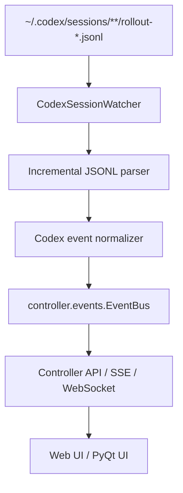

# Codex Session Watcher Implementation Plan

## Goal

`aituber-talk` に、Codex のローカルセッションを監視して差分イベントを受け取り、アプリ側のセッション表示や将来の agent mode に反映できる仕組みを追加する。

対象 OS は macOS。Linux の `epoll` / `inotify` 相当として、macOS では FSEvents を使う。Python からは低レベル FSEvents API を直接扱わず、`watchfiles` を利用する。

## Scope

監視対象は大きく 2 つに分ける。

1. Codex session event
   - `~/.codex/sessions/**/*.jsonl`
   - `rollout-*.jsonl` に append される JSONL イベントを増分読み取りする。
   - 会話、tool call、tool result、agent message、token count などの「何が起きたか」を扱う。

2. Workspace file diff
   - Codex が作業している repository / working directory
   - Git repository なら `git status --porcelain` と `git diff` を使う。
   - Git repository でない場合は mtime / size / hash snapshot で差分を取る。
   - 「成果物として何が変わったか」は session JSONL ではなく workspace 側から判断する。

Codex の内部ファイルは読み取り専用にする。`~/.codex/sessions` や `~/.codex/sqlite` を外部から更新しない。

## Why `watchfiles`

macOS では `watchfiles` が Rust の notify backend 経由で FSEvents を使う。Python 実装側は以下だけに集中できる。

- 再帰監視
- 変更された JSONL ファイルの特定
- byte offset からの増分読み取り
- 不完全 JSONL 行の buffering
- controller event bus への publish

`watchdog` でも実装できるが、まずは `watchfiles` を採用する。依存は `requirements.txt` に追加する。

```text
watchfiles
```

## Proposed Modules

追加候補は以下。

```text
core/codex_watcher.py
controller/codex_events.py
```

`core/codex_watcher.py` は Codex session JSONL の監視と parse のみを担当する。controller や UI には依存しない。

`controller/codex_events.py` は watcher のイベントを既存の `controller.events.EventBus` に流す adapter とする。

将来的に agent mode へ組み込む場合も、watcher の core 実装はそのまま使い、controller 側で購読先を差し替える。

## Event Flow



## Incremental Read Strategy

各 JSONL ファイルごとに以下の状態を持つ。

- `path`
- `offset`
- `partial_buffer`
- `last_seen_mtime`
- `last_event_timestamp`

FSEvents の通知は「wake up signal」として扱う。通知の粒度に依存しない。通知を受けたら、対象ファイルを現在の offset から read し、改行で閉じた行だけ JSON として parse する。

最後の行が改行で閉じていない場合は `partial_buffer` に残し、次の変更時に結合して parse する。

ファイルサイズが保存済み offset より小さくなった場合は truncate / rotate とみなし、offset を 0 に戻す。

## Event Selection

Codex の JSONL には複数種類のイベントが入る。最初の実装では以下を優先する。

- `event_msg.agent_message`
- `event_msg.exec_command_end`
- `response_item.function_call`
- `response_item.function_call_output`
- `response_item.message`

リアルタイム性が必要な表示では `event_msg.*` を優先する。実測では tool 実行終了から JSONL 追記までおおむね 50-200ms 程度だった。`response_item.function_call_output` は並列 tool や長時間 tool の都合で遅れて記録される場合がある。

## Normalized Event Shape

controller へ渡すイベントは Codex 内部 JSON をそのまま流さず、最低限の形に正規化する。

```python
{
    "source": "codex",
    "session_file": "/Users/.../.codex/sessions/2026/05/06/rollout-....jsonl",
    "timestamp": "2026-05-05T16:09:40.413Z",
    "codex_event_type": "event_msg",
    "payload_type": "exec_command_end",
    "turn_id": "019df8e4-...",
    "call_id": "call_...",
    "cwd": "/Users/seagetch/src/github/aituber-talk",
    "summary": "...",
    "raw": {...}
}
```

`raw` は初期段階では保持してよい。ただし UI が `raw` に直接依存しないようにする。

## Workspace Diff Strategy

Codex session event は「操作ログ」であり、「成果物の差分」ではない。成果物差分は workspace watcher で別に取る。

Git repository の場合:

```bash
git status --porcelain
git diff --stat
git diff -- path/to/file
```

実装では session event の `cwd` を見て repository root を解決し、短い debounce の後に diff snapshot を更新する。

debounce の目安:

- session event 追従: 100-250ms
- workspace diff 更新: 300-1000ms

大きな生成物があるため、初期実装では `uploads/`, `SadTalker/`, `.venv/`, `__pycache__/`, `tmp_*` は監視・diff 表示から除外する。

## Controller Integration

既存の `EventBus` を使い、watcher から以下の event type を publish する。

```text
codex.session_event
codex.command_finished
codex.agent_message
codex.workspace_diff_changed
codex.watcher_error
```

UI は controller の既存 real-time endpoint から購読する。watcher 専用の UI 通信経路は作らない。

## Persistence

watcher の offset は process memory だけでも動くが、再起動後に重複イベントを避けるため、小さな state file を持つ。

候補:

```text
.aituber/codex_watcher_state.json
```

保存内容:

```json
{
  "/Users/.../rollout-xxx.jsonl": {
    "offset": 123456,
    "last_event_timestamp": "2026-05-05T16:09:40.413Z"
  }
}
```

初期実装では `~/.codex` 側には state を書かない。project local の `.aituber/` 配下に保存する。

## Error Handling

- JSON decode error
  - 不完全行なら buffer に残す。
  - 改行済みで parse 不能なら `codex.watcher_error` として報告して読み飛ばす。

- Permission error
  - watcher を止めず、対象 path と error を publish する。

- Missing file
  - Codex が session file を移動・archive した可能性があるため、offset state を残して無視する。

- Event storm
  - `watchfiles` の batch event を path 単位で deduplicate する。
  - workspace diff は debounce する。

## Minimal Implementation Sketch

```python
from pathlib import Path
from watchfiles import Change, watch

ROOT = Path.home() / ".codex" / "sessions"

def is_rollout(path: Path) -> bool:
    return path.name.startswith("rollout-") and path.suffix == ".jsonl"

def run():
    for changes in watch(ROOT, recursive=True):
        touched = {
            Path(path)
            for change, path in changes
            if change in {Change.added, Change.modified}
            and is_rollout(Path(path))
        }

        for path in touched:
            read_incremental_jsonl(path)
```

この loop を controller 起動時の background thread / task として開始する。

## Testing Plan

1. Unit tests
   - 完全な JSONL 行を parse できる。
   - 分割書き込みされた JSONL 行を buffer して parse できる。
   - truncate 時に offset を 0 に戻す。
   - parse 不能行で watcher が停止しない。

2. Integration tests
   - 一時ディレクトリに `rollout-*.jsonl` を作り、追記イベントを受け取れる。
   - `EventBus` に `codex.session_event` が publish される。
   - debounce 後に workspace diff event が publish される。

3. Manual verification
   - Codex session 実行中に `~/.codex/sessions` を監視する。
   - tool call 完了から UI 更新までがサブ秒であることを確認する。
   - 複数 session file がある状態で最新 session だけでなく全 session の追記を拾えることを確認する。

## First Milestone

最初の実装では以下に限定する。

- `watchfiles` dependency 追加
- `core/codex_watcher.py` 追加
- JSONL incremental parser
- `EventBus` adapter
- `codex.session_event` と `codex.command_finished` の publish
- unit tests

workspace diff watcher と UI 表示は第 2 段階で追加する。
